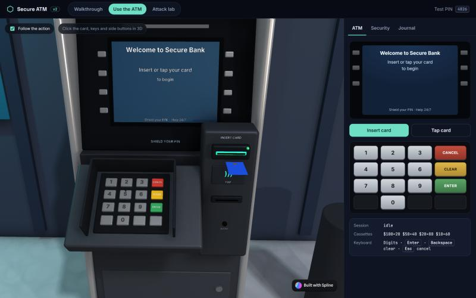
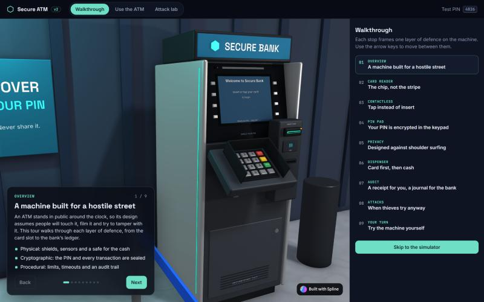
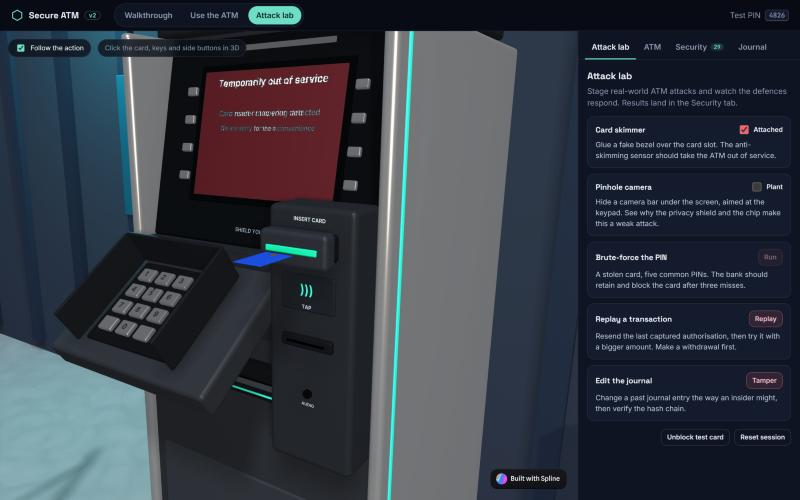
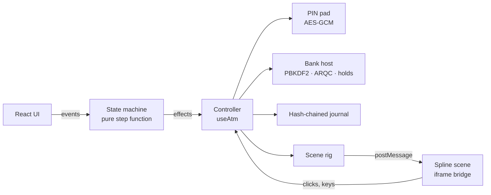

# Secure ATM Simulator

An ATM simulator that explains how a real cash machine keeps your money safe, built around an interactive 3D machine made in [Spline](https://spline.design).

- **Walkthrough:** a guided 3D tour, one stop per layer of defence: chip reader, contactless, encrypting PIN pad, privacy design, card-before-cash dispensing and the audit journal.
- **Use the ATM:** a full session on the 3D machine. Click the card, the keys and the side buttons in 3D, or use the keyboard.
- **Attack lab:** stage skimming, brute-force, replay and insider log-tampering attacks, and watch each defence respond.

Test card PIN: **4826**



| Walkthrough | Attack lab |
| --- | --- |
|  |  |

## What's real and what's simulated

The security mechanics use real cryptography from the browser's Web Crypto API. The bank and the hardware are simulated.

| Layer | How it works here |
| --- | --- |
| PIN entry | Digits stay inside the PIN pad module. It builds an **ISO 9564 format 0 PIN block** (PIN XOR card number) and encrypts it with **AES-256-GCM** under a non-extractable key. The state machine and UI only ever know how many digits were typed. |
| PIN check | The bank side decrypts the block and compares a **PBKDF2-SHA256** hash (100,000 iterations, per-card salt) in **constant time**. The retry counter lives on the bank side, so re-inserting the card doesn't reset it. Three misses retain the card and block it. |
| Transactions | The chip produces an **ARQC-style cryptogram**: HMAC-SHA256 over card number, amount, transaction counter (ATC) and the terminal's random number. The bank rejects replays (counter not increasing) and altered amounts (cryptogram mismatch). |
| Money | Integer cents throughout. Withdrawals place a **hold**; the account is only debited when the cash is taken, and the hold is reversed if the cash or card is left behind. Daily limit $1,000. |
| Dispenser | Exact **bounded-knapsack** planning picks the fewest notes the cassettes can supply, and refuses amounts the inventory can't make. |
| Journal | Append-only event log with a **SHA-256 hash chain**. Editing any entry breaks verification from that entry on. |
| Session | **Card before cash**; a 30-second inactivity prompt; cards and cash not taken in time are retained or retracted. Late timers can't fire into a later screen. |

Simplified on purpose: real ATMs use DUKPT/TR-31 key management, ISO 8583 or host-specific messaging, and certified tamper-responsive hardware. See [docs/OVERHAUL.md](docs/OVERHAUL.md) for the reasoning behind each choice.

## How the 3D scene works on Spline's free plan

Spline's free plan has no code export and no variables, so the app embeds the scene's **public URL** in an iframe. The scene's HTML layer contains a small, generic `postMessage` bridge (namespace `secure-atm/v1`):

- **Into the scene:** `call` (any `spline.*` method, e.g. `updateObject` to move parts or change text), `tween`, `look` (camera position + target) and `ping`.
- **Out of the scene:** `ready`, `event` (`mouseDown` on named objects such as `Key 5 Cap` or `FDK L2`), `key`, `result` and `done`.

All ATM logic lives in this repo. The scene only exposes named parts, so behaviour changes never need Spline edits. Scene: https://my.spline.design/untitled-fi7QL4QNs4vZrFF10dTnEn52/



## Getting started

Requires Node.js 18+.

```bash
npm install
```

```bash
npm run dev
```

Then open http://localhost:5173. The 3D scene loads from Spline, so you need a network connection. If it can't load, the side panel still runs the whole simulator.

```bash
npm test
```

44 unit tests cover the state machine, PIN blocks, PIN policy, the bank host (replay, forgery, holds, limits, lockout), the dispenser and the journal.

## Controls

| Action | 3D scene | Keyboard |
| --- | --- | --- |
| Insert / tap card | Click the card / the contactless pad | `Enter` on the welcome screen |
| PIN and amounts | Click the keypad | Digits, `Backspace` to clear, `Enter` |
| Screen options | Click the side keys next to the screen | `1`-`6`, or `F1`-`F3` (left) and `F5`-`F7` (right) |
| Cancel / back | Red CANCEL key | `Esc` |
| Take card, cash, receipt | Click them when they come out | Buttons in the side panel |

## Project structure

```
src/
  core/        pure logic: state machine, screens, i18n (EN/FR/ES), security, PIN pad, bank host, dispenser, journal
  scene/       Spline bridge client, hardware rig, camera shots
  app/         controller hook, walkthrough chapters, sounds
  components/  stage, walkthrough, operator panel, inspector, journal, attack lab
```

## Version 1

The original CS3231 Computer Graphics build (Three.js, custom GLSL shaders, hand-written Bresenham, Bézier and clipping routines) is preserved at the `v1-cs3231` tag. [Technical_Report.md](Technical_Report.md) documents that version.

## License

MIT. See [LICENSE](LICENSE).
